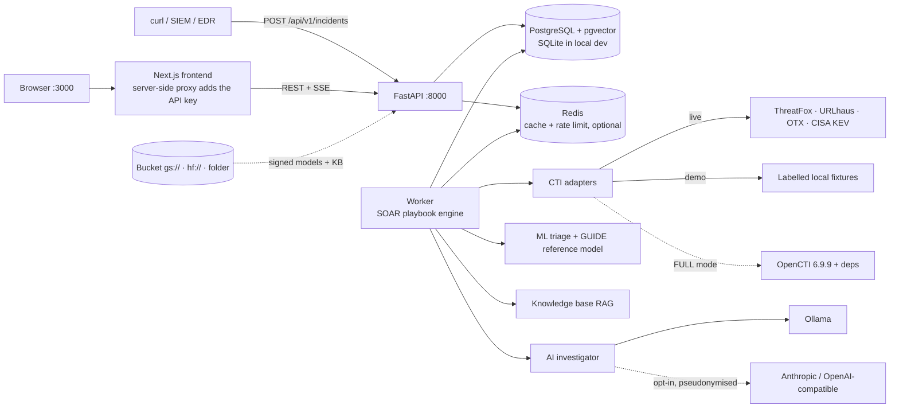

# Architecture

Sfumato Autonomous SOC takes a security incident (JSON), investigates it with a real SOAR playbook and shows an
explainable verdict. Nothing in the pipeline is pre-computed, and **no response action is ever executed**.



## Components

| Component | Where | Role |
|---|---|---|
| API | `backend/app/api`, `main.py` | Ingestion, queries, SSE stream, settings. Strict Pydantic schema, API-key auth, rate limit, size limit |
| Worker | `backend/app/workers/worker.py` | Claims queued incidents (`FOR UPDATE SKIP LOCKED`), heartbeats, requeues stale jobs. Embedded in the API for local use (`EMBEDDED_WORKER=true`), a separate container in Docker |
| SOAR engine | `backend/app/soar/engine.py` | Runs the YAML playbook as a dependency graph: parallel branches, `when` conditions, retries with backoff, timeouts, abort/continue policies, persisted task state |
| Playbook | `playbooks/sfumato_autonomous_investigation.yml` | 18 nodes covering the 16 stages of the specification |
| CTI | `backend/app/cti` | One adapter per provider (fetch + pure `parse`), privacy filter, cache, correlation into evidence |
| Behaviour | `backend/app/services/behavior.py`, `config/organization.yml` | Deterministic rules + organisation context (change register, approved software, admins) |
| ML | `backend/app/ml` | Triage model (synthetic data) and GUIDE reference model, both able to abstain |
| Knowledge base | `backend/app/knowledge` | Semantic search over defensive guidance (reference material, not evidence) |
| AI investigator | `backend/app/agents` | LLM or deterministic report, validated against the evidence book |
| Decision engine | `backend/app/decision/engine.py` | Transparent rules → verdict, threat score, confidence |
| Artifact storage | `backend/app/storage/artifacts.py` | Signed, versioned model/KB artifacts in a bucket |
| Frontend | `frontend/` | Next.js dashboard (7 pages) |

## Investigation flow

1. `POST /api/v1/incidents` validates the JSON, stores it (`queued`) and emits the first event.
2. A worker claims it and runs the playbook:

```
receive → validate → normalize → extract indicators → classify assets ─┬─► query CTI → correlate CTI ─┐
                                                                        └─► analyse behaviour ─────────┤
                              generate features ◄───────────────────────────────────────────────────────┘
                                   ├─► ML inference (+ GUIDE reference model)
                                   └─► retrieve knowledge ─► (both) ─► AI investigator → validate agent output
                              → compute verdict → generate actions (+ human review routing) → store report → publish
```

3. Every task start/finish, log line, CTI answer and milestone is written to `investigation_events`. The SSE endpoint
   replays that table, so the dashboard only shows events that really happened and a reopened incident replays exactly.
4. The report is stored on the incident; the dashboard reads it through the API.

Ten **milestones** (JSON received … recommended actions available) drive the animated pipeline in the UI.

## Evidence model

Every analysis stage writes *evidence* with a stable ID: `EV-BEH-*` (behaviour), `EV-CTX-*` (organisation context),
`EV-CTI-*` (threat intelligence), `EV-INT-*` (integrity, e.g. prompt-injection attempts), `EV-ML-*` (model outputs),
`EV-KB-*` (knowledge-base passages). The AI report must cite these IDs; claims citing unknown IDs are dropped.
`EV-KB-*` is reference material: it is neutral, weight 0 and invisible to the decision engine.

## Decision engine (summary)

Three separate numbers: **threat score** (0-100, from weighted evidence), **ML probabilities** (a bounded input:
max 15 points; GUIDE reference model max 10; AI vote max 5) and **verdict confidence**. Verdicts: `TRUE_POSITIVE`,
`FALSE_POSITIVE` (the detection misidentified approved/sanctioned activity), `LEGITIMATE_ACTIVITY` (the behaviour
happened but was authorised, e.g. a verified change), `INCONCLUSIVE` (insufficient or contradictory evidence).
Thresholds live in `DecisionConfig` (override with `config/decision.json`). Human review is a separate flag; an
incident can be `completed`, `needs_review` or `failed`.

## Data model (PostgreSQL / SQLite, Alembic migrations)

`incidents`, `investigation_events`, `playbook_runs`, `task_runs`, `cti_queries` (raw provider responses kept),
`provider_credentials` (Fernet-encrypted), `audit_logs`. Migrations run automatically at start-up
(`app/database/migrate.py`, advisory-locked so the API and worker containers do not race).

## Deployment modes

* **LITE (default)**: Postgres (pgvector), Redis, API, worker, frontend. ~2-3 GB RAM. Direct CTI adapters.
* **FULL**: adds OpenCTI Community Edition (Elasticsearch, MinIO-compatible storage, RabbitMQ, workers and the MITRE
  ATT&CK / CISA KEV connectors) through `docker-compose.full.yml`. ~12-16 GB RAM. Never substituted silently:
  `DEPLOYMENT_MODE` is reported by `/api/v1/status` and shown in the UI.
* **SOAR choice**: a lightweight Python engine instead of Shuffle (see below). No external SOAR is connected.

### Why not Shuffle?

Shuffle needs its own backend, frontend, OpenSearch and executor, several GB of RAM and a second tool to configure.
For a demo that must be reliable on one machine, that complexity was not justified, so a real (not simulated)
playbook engine was written. It was **not** benchmarked against Shuffle. A Shuffle webhook integration would be an
additive option, not a replacement.

## Known limits

* The reference ML model is trained on synthetic data (see MACHINE_LEARNING.md).
* Docker deployment, the real GCS bucket, real Kaggle runs and a real OpenCTI instance have not been exercised by the
  authors of this repository's tests; unit/integration tests cover the code paths with simulated backends.
